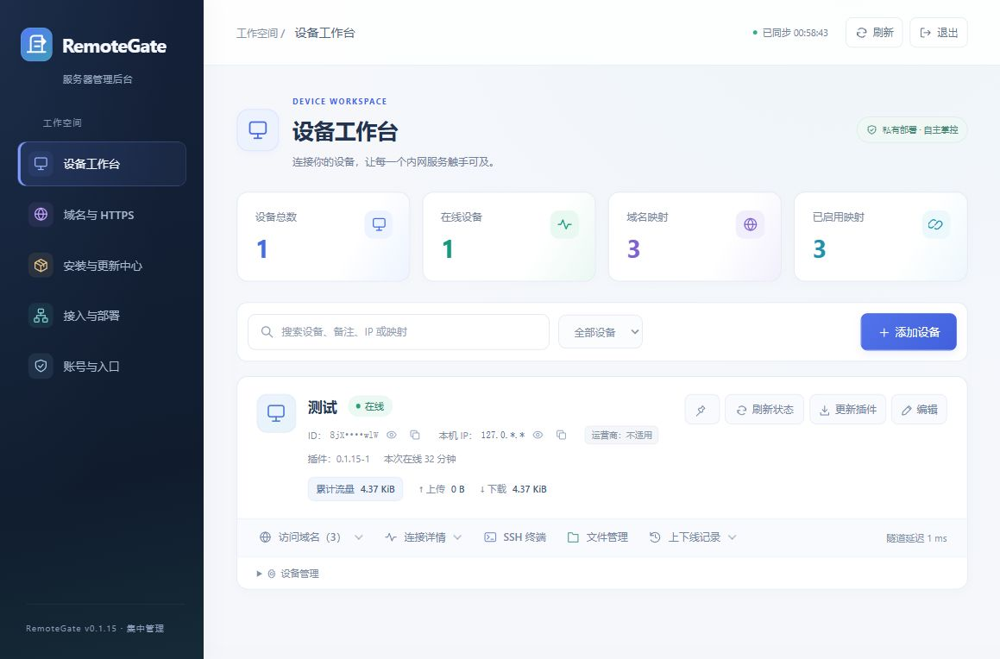
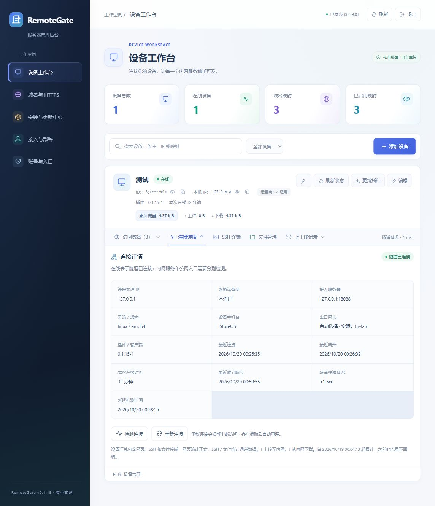
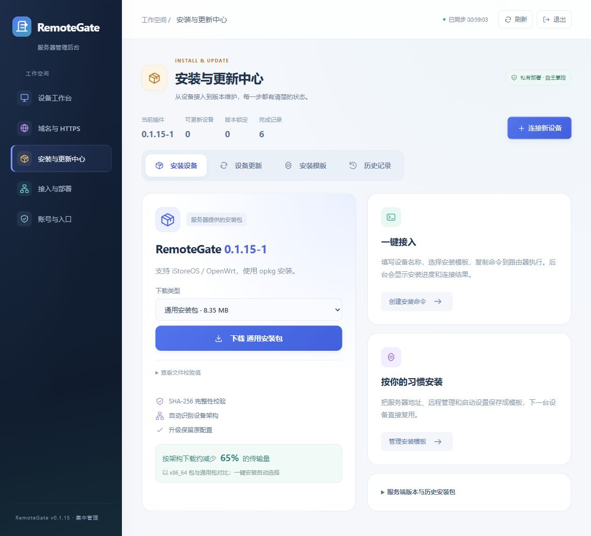

# RemoteGate

[](https://github.com/yehao9589/remotegate/releases/latest)

**用自己的服务器，远程打开家里的路由器、NAS 和内网网站。**

RemoteGate 由服务器后台和路由器插件组成。路由器主动连接服务器，不需要家庭宽带有公网 IP，也不需要在路由器上开放入站端口。

[开始部署](DEPLOYMENT.md) · [宝塔安装](docs/deployment/baota.md) · [路由器接入](docs/deployment/router.md) · [更新记录](CHANGELOG.md) · [版本下载](https://github.com/yehao9589/remotegate/releases)

## 能做什么

| 功能 | 说明 |
| --- | --- |
| 远程访问 | 为路由器、NAS 和内网网站设置各自的访问域名 |
| 访问保护 | 映射默认要求后台登录，也可单独设为公开访问 |
| 设备管理 | 查看连接 IP、运营商、实际出口网卡、延迟和上下线记录，支持单台刷新状态 |
| 流量统计 | 分别查看每台设备、每条映射的累计上传和下载 |
| SSH 与文件管理 | 在浏览器打开终端、浏览文件、上传和下载，使用目标设备原有的 SSH 账号 |
| 插件更新 | 从路由器页面或管理后台更新，保留配置；支持失败自动恢复旧插件 |
| 版本与更新 | 从左下角检测最新正式版，在后台查看当前版本和历史更新说明 |
| HTTPS 检测 | 检查访问地址的证书、域名和到期时间 |

路由器插件自动选择直连出口，优先使用 WAN；没有有效 WAN 路由时，也能使用 LAN 等接口的上联网关，并为自身连接配置 OpenClash 绕过规则。后台标注实际使用的网卡；没有可用直连出口时提示错误，不自动改走代理。服务端和插件都需更新到支持此功能的版本。

## 后台预览

以下为本地测试环境实拍，设备 ID 和卡片 IP 保持默认遮罩。

**设备工作台**：查看设备在线状态、流量和常用操作。



<details>
<summary>查看更多：连接详情、安装与更新中心</summary>

**连接详情**：查看实际出口网卡、连接时间和隧道延迟。



**安装与更新中心**：下载插件、连接新设备、管理安装模板。



</details>

## 开始使用

### 1. 准备服务器和域名

- 一台有公网访问入口的 Linux 服务器，已安装 Docker 和 Docker Compose。
- 一个域名，用于后台及设备访问地址。
- 一台支持插件的 iStoreOS / OpenWrt 路由器：支持 x86_64、ARM64、ARMv7，使用 opkg 包管理。

服务端只需一个容器，不需要数据库。官方镜像已内置路由器安装包。

### 2. 安装服务端

按自己的情况选择一篇教程即可：

| 你的情况 | 从这里开始 |
| --- | --- |
| 已经使用宝塔 | [宝塔界面安装](docs/deployment/baota.md)，沿用 RemoteGate 对应站点的 HTTPS 入口 |
| 使用服务器命令行 | [Docker Compose 安装](docs/deployment/docker-cli.md) |
| 不想克隆代码仓库 | [下载部署包安装](docs/deployment/release-package.md) |

其他部署方式见[部署指南](DEPLOYMENT.md)。已有宝塔 / Nginx 占用 443 时，按对应教程配置 RemoteGate 的入口，不要直接套用独立监听 443 的配置。

入口配置完成后，打开 `https://你的后台域名/install`，创建管理员账号、密码和后台入口。**请收藏安装完成后的后台地址**，默认是 `/admin`；首次安装完成后，`/install` 不再用于登录。

### 3. 接入路由器

在后台点击“添加设备”，选择一种方式：

- **一键安装**：把后台生成的命令复制到路由器终端执行。
- **手动安装**：从“安装与更新中心”下载插件，在 iStore 的“手动安装”上传，然后填写服务器地址、设备 ID 和设备令牌。

服务器地址示例：`https://gate.example.com`，**不带 `/admin` 等后台路径**。安装后确认插件显示已连接，后台显示设备在线。

详细步骤和连接问题见[路由器接入教程](docs/deployment/router.md)。

### 4. 添加访问域名

在设备卡片中展开“访问域名”，添加内网服务。例如：

| 想访问的服务 | 公网访问地址 | 内网目标示例 |
| --- | --- | --- |
| 路由器管理页 | `https://router.gate.example.com/` | `http://127.0.0.1:80` |
| NAS 管理页 | `https://nas.gate.example.com/` | `http://192.168.1.20:5000` |

示例中的域名和内网地址需要换成你自己的。这里的 `127.0.0.1` 指**运行插件的路由器**。

使用前，需让域名解析、站点反代和 HTTPS 证书覆盖这些访问地址。宝塔用户可按[泛域名与 HTTPS 教程](docs/deployment/external-https.md)一次配置主域名和对应的泛域名。

## 怎么更新

**服务端镜像和路由器插件分开更新。**

1. 备份现有数据目录和部署配置。
2. 更新服务器镜像：宝塔用户重新拉取镜像并重新部署；命令行用户在原编排目录执行下方命令。
3. 登录后台核对版本，再通过“更新插件”升级路由器插件。更新时会短暂断开，设备信息和映射保留。

```sh
docker compose pull
docker compose up -d
```

默认镜像为 `ghcr.io/yehao9589/remotegate:stable`，跟随正式发布。**只重启容器不会升级；更新时保留原数据目录和 `.env`。** 源码构建的更新命令不同，见[源码教程](docs/deployment/source.md#4-后续更新)。

旧插件没有在线更新功能时，后台会提供首次升级方法。完整说明见[更新与备份](docs/deployment/maintenance.md)和[插件在线更新](docs/deployment/router.md#插件在线更新)。

## 常见问题

**任何人拿到访问地址都能打开吗？**

默认需要通过 RemoteGate 后台验证身份。路由器、NAS 原有的登录仍然保留。只有明确设为“公开访问”的映射才不要求后台登录。[了解访问保护](docs/deployment/mapping-access.md)

**证书在哪里处理？**

使用宝塔 / Nginx 入口时，在实际提供 HTTPS 的站点申请、启用和续期证书，RemoteGate 后台检查公网结果。证书正常不代表设备或内网服务一定在线。[查看 HTTPS 教程](docs/deployment/external-https.md)

**为什么设备在线，网站却打不开？**

在线只说明路由器与服务器已连接。还需检查内网目标是否可访问，以及域名解析、证书和反代是否正确。返回 `unknown host` 时，重点检查映射域名和反代是否保留原始 Host。[查看排查方法](docs/deployment/external-https.md#常见问题)

**后台显示的 IP 是什么？**

它是服务器看到的设备连接来源；经过代理时可能是代理出口。实际网卡由新版插件上报，自动选择时也会显示；离线后标注上次使用的网卡。

**流量数字和云服务器账单一样吗？**

不完全一样。页面统计转发的数据，不包含全部网络协议开销；SSH 和文件传输计入设备流量，不计入某条网页映射。[查看统计口径](docs/traffic.md)

## 更多说明

- [设备状态与上下线记录](docs/device-status.md)
- [SSH 终端与文件管理](docs/deployment/remote-access.md)
- [安装模板、批量更新与更新记录](docs/deployment/install-center.md)
- [版本发布流程](docs/releasing.md)

**当前限制**：网页域名映射暂不支持目标网站的 WebSocket，请求和响应正文各不超过 16 MiB；SFTP 文件传输使用独立通道。暂不支持 RDP / VNC 和多服务端高可用。

<details>
<summary>开发与源码构建</summary>

[从源码构建 Docker 镜像](docs/deployment/source.md)会同时生成服务端和三个架构的路由器插件，无需单独复制安装包。

本地开发使用仓库要求的 Go 版本运行：

```sh
go run ./cmd/server
```

打开 `http://127.0.0.1:18088/install` 创建本地测试账号。已有安装继续使用原来的后台入口。测试命令：

```sh
go test ./...
```

路由器界面源码在 `deploy/openwrt/luci/`，版本信息在 `internal/buildinfo/release.json`，更新说明在 [CHANGELOG.md](CHANGELOG.md)。

</details>
